<div align="center">

# HTML Content Extractor

**Paste a page's HTML. Get every piece of content, an SEO audit, and a cross-page comparison, all on your own computer.**

Plain HTML, CSS and JavaScript · No install · No build step · No server · Works offline

<br>

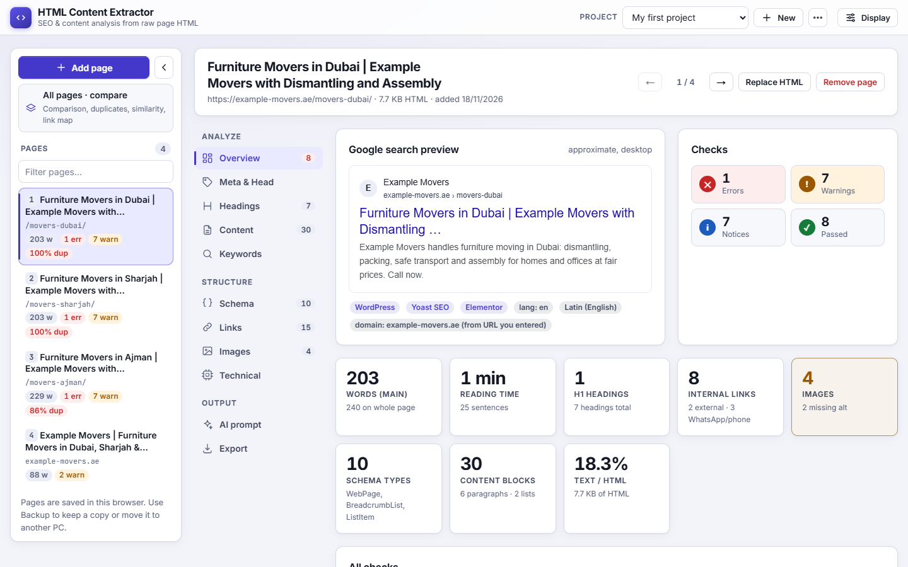

</div>

<br>

## Contents

- [Why this tool](#why-this-tool)
- [Quick start](#quick-start)
- [Features](#features)
- [Screenshots](#screenshots)
- [Workflow](#workflow)
- [Report reference](#report-reference)
- [Display settings and shortcuts](#display-settings-and-shortcuts)
- [Privacy and storage](#privacy-and-storage)
- [Project structure](#project-structure)
- [Development and testing](#development-and-testing)
- [Browser support](#browser-support)
- [Notes and limitations](#notes-and-limitations)

## Why this tool

SEO and content audits usually start with the same chore: open a page, view source, and dig out the title, meta tags, schema, headings, body text, links and images. This app does that in one step. Paste the page's HTML and it extracts everything in order, runs SEO checks, and builds exports (Markdown, JSON, CSV) and ready-to-paste AI prompts.

Add several pages and it compares them: duplicate titles, keyword cannibalization, near-duplicate "template" pages that differ only by a city or service name, and how the pages link to each other.

It was built for agency and in-house SEO work. It handles Arabic and right-to-left pages, and it reads page-builder output (Elementor, Next.js) and Yoast/Rank Math schema.

## Quick start

1. Download or unzip the folder anywhere on your PC.
2. Double-click **`index.html`** to open it in Chrome or Edge.
3. Click **Load sample pages** to explore with four fictional pages, or paste your own.

That is all. There is nothing to install, and your HTML never leaves your computer.

### How to get a page's HTML

Open the page in Chrome, then:

1. Right-click the page and choose **Inspect**.
2. In the Elements panel, right-click the `<html>` tag.
3. Choose **Copy → Copy element**.
4. Paste it into the app and press **Add & open page** (or `Ctrl` + `Enter`).

You can also drop or open a saved `.html` file. Entering the page URL is optional but recommended. It helps resolve relative links, tell internal links from external ones, and build the internal link map. If you leave it empty, the tool uses the canonical or `og:url` tag instead.

<div align="center">
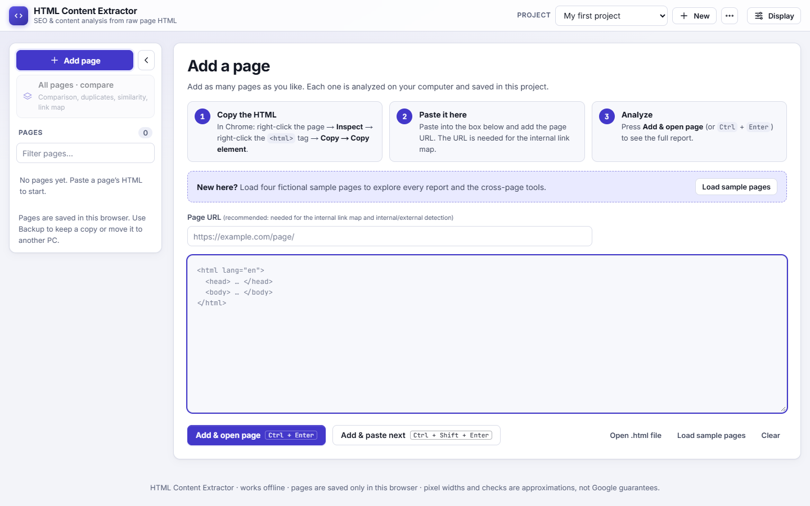
</div>

## Features

**Single-page analysis**

- **Overview:** a Google search preview (title and description truncated by pixel width), key statistics, and every SEO check sorted by severity.
- **Meta & Head:** title and description length meters, canonical, robots, viewport, language and direction, favicons, Open Graph preview card, Twitter cards, hreflang, verification tags, and every meta and link tag.
- **Schema:** each JSON-LD block as a collapsible tree (Yoast/Rank Math `@graph` split into entities), recommended-property checks, FAQ text compared with the visible page, Microdata, RDFa, and links to Google's Rich Results Test.
- **Headings, Content, Links, Images:** the full outline, every content block in order, every link with its type and issues, and every image with alt text, dimensions and loading behaviour.
- **Keywords:** a focus-keyword check across title, description, H1, subheadings, first paragraph, URL, alt text and anchors, plus 1-, 2- and 3-word phrase density (Arabic and English stop words skipped).
- **Technical:** platform and plugin detection (WordPress, Yoast, Rank Math, Elementor, Next.js, Shopify and more), tracking IDs, scripts, stylesheets, resource hints and HTML comments.

**Projects and bulk analysis**

- **Projects:** one project per client or site. Pages are saved in your browser, and a single-file **backup** moves a project to another PC.
- **Comparison:** one sortable table across all pages, with CSV download.
- **Duplicates & cannibalization:** duplicate titles, descriptions, H1s and canonicals, missing elements, and pages whose title and H1 target the same words.
- **Near-duplicate content:** a similarity matrix and page pairs. *Template similarity* hides the words that make each page different, so it catches location pages that are the same text with the city swapped.
- **Internal link map:** body-content links versus menu and footer links, orphan pages, anchor texts, and the most-linked internal URLs you have not added yet.

**Output**

- **Exports:** Markdown (main content or full report), full JSON, CSVs for links, images, headings, meta tags and content blocks (UTF-8 with BOM, so Arabic opens correctly in Excel), and print or save as PDF.
- **AI prompts:** per-page prompts (rewrite, content brief, audit, meta options, FAQ and schema, translation, make-unique) and project-wide prompts (differentiate duplicates, unique titles and metas, internal linking plan, resolve cannibalization).

**Interface**

- App-style layout: pages sidebar, grouped report navigation, and a project menu.
- Light, dark or system theme, and comfortable or compact density.
- Sticky table headers, copy buttons everywhere, and full keyboard support.

## Screenshots

All screenshots show fictional English-language pages for an imaginary moving company. No real site or data is shown.

<table>
  <tr>
    <td width="50%"><b>Meta & Head</b><br>Length meters, canonical, robots and the Open Graph card.<br>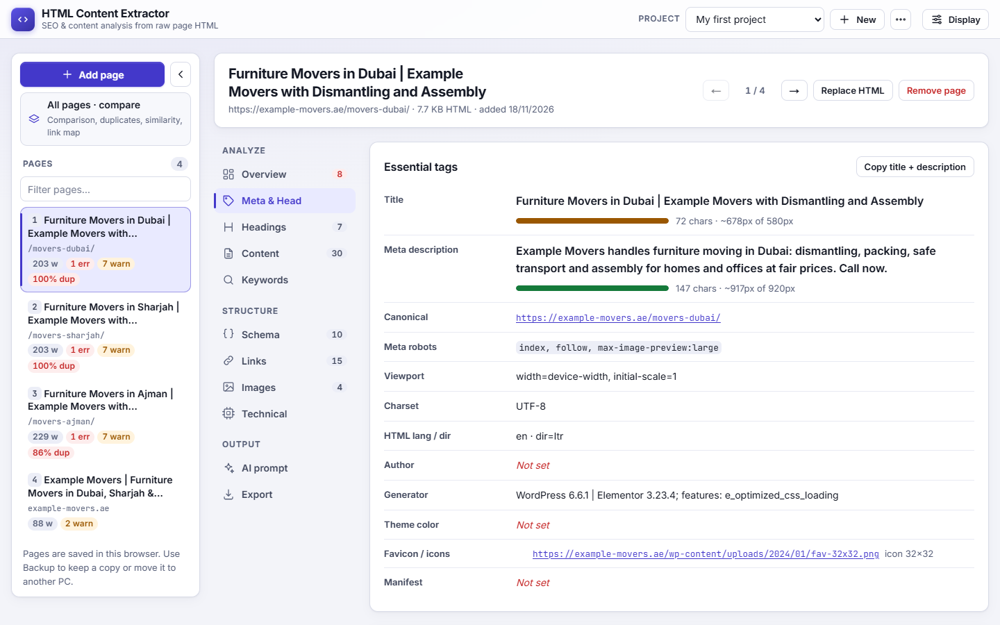</td>
    <td width="50%"><b>Schema</b><br>JSON-LD as a tree, with recommended-property checks.<br>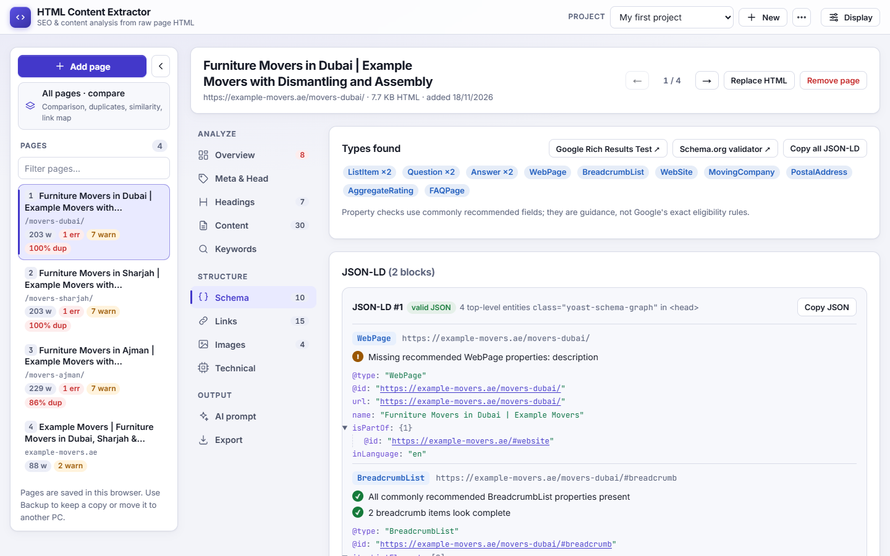</td>
  </tr>
  <tr>
    <td><b>Content</b><br>Every block in order, grouped by page region.<br>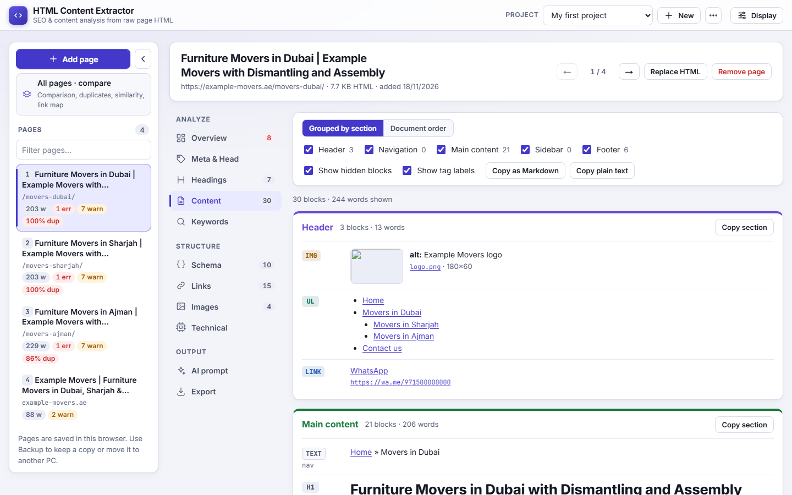</td>
    <td><b>Links (compact density)</b><br>Type, section, rel and issue flags for every link.<br>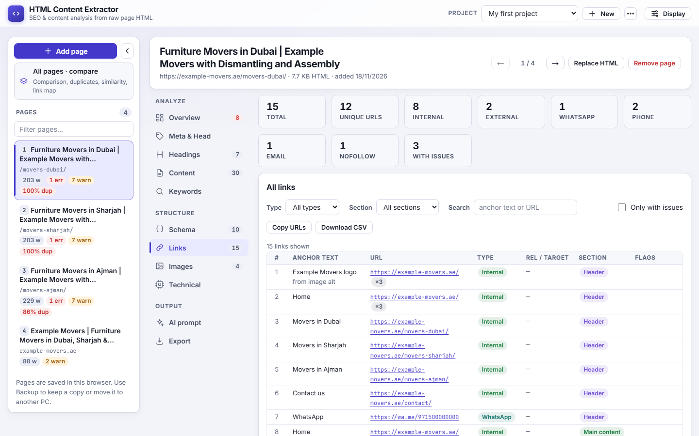</td>
  </tr>
  <tr>
    <td><b>All pages · Comparison</b><br>One sortable table with pinned page columns.<br>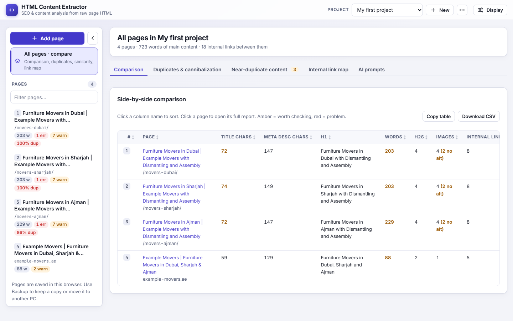</td>
    <td><b>Duplicates & cannibalization</b><br>Shared titles, descriptions, H1s and overlapping targets.<br>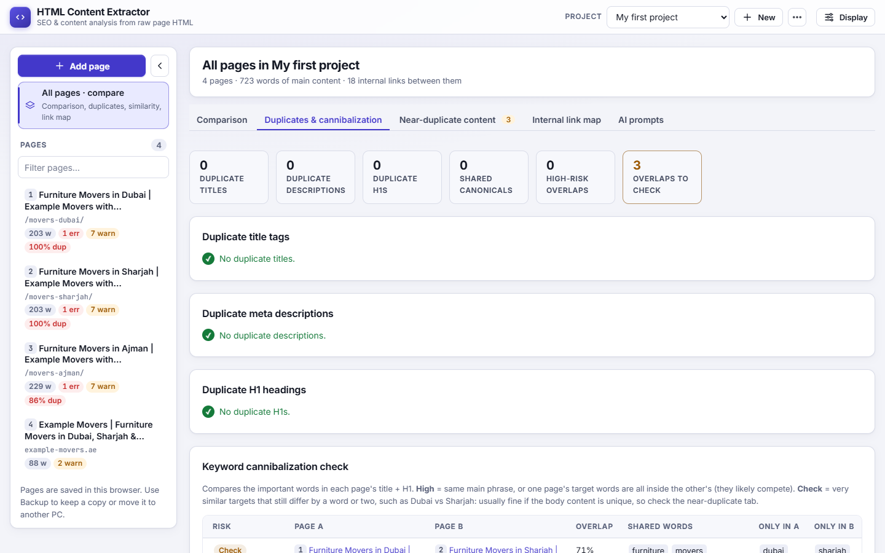</td>
  </tr>
  <tr>
    <td><b>Near-duplicate content</b><br>Similarity heat map and page pairs.<br>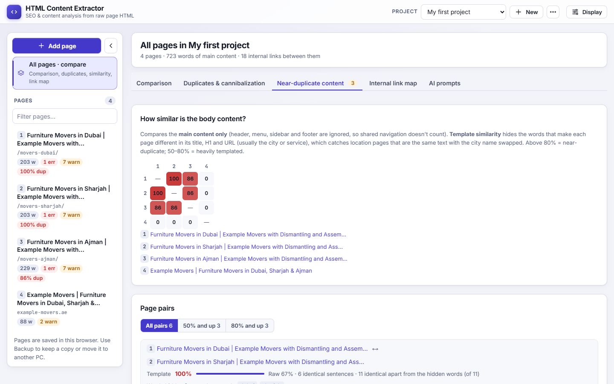</td>
    <td><b>Internal link map</b><br>Orphans, body-content links and anchor texts.<br>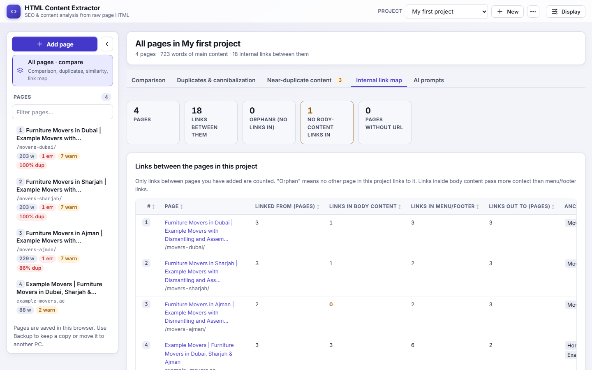</td>
  </tr>
  <tr>
    <td><b>Export</b><br>Markdown, JSON, CSV and print.<br>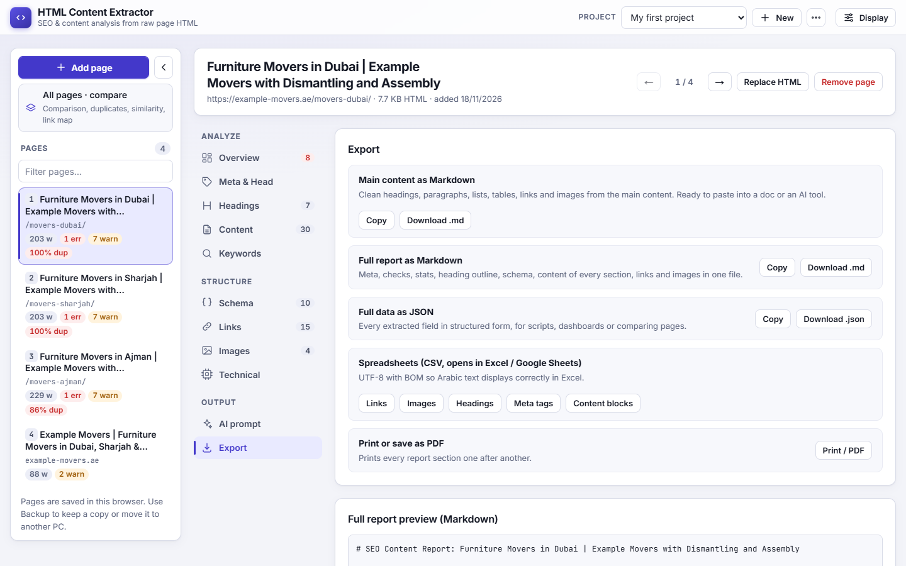</td>
    <td><b>AI prompt</b><br>Ready-to-paste prompts built from the page data.<br>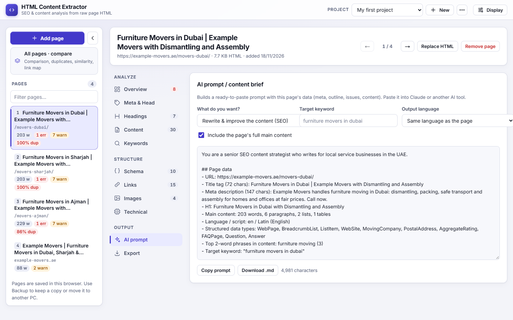</td>
  </tr>
</table>

### Dark mode

<div align="center">
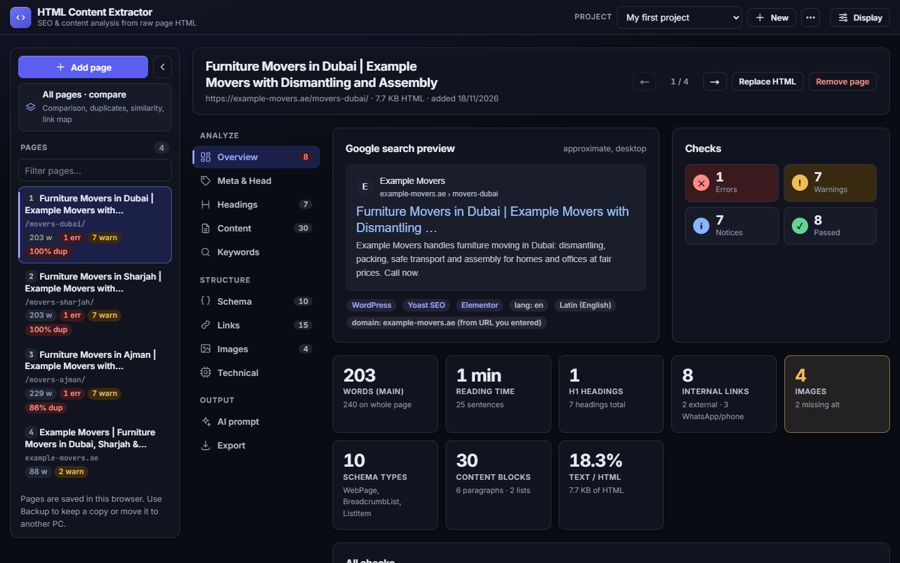
</div>

## Workflow

1. **Create a project** for a client or website. Use **New** in the top bar. **Rename**, **Back up**, **Import backup** and **Delete** are in the `⋯` menu next to it.
2. **Add pages** one at a time:
   - **Add & open page** (`Ctrl` + `Enter`) saves the page and opens its report.
   - **Add & paste next** (`Ctrl` + `Shift` + `Enter`) saves it and clears the form for the next page.
   - Adding a URL that is already in the project replaces that page.
3. **Review each page.** Click a page in the sidebar. The ← → buttons step through pages, and the section you are on stays open, so you can check the same thing on every page quickly. Use **Replace HTML** to update a page or **Remove page** to delete it.
4. **Compare.** Open **All pages · compare** for the cross-page tools.
5. **Export or hand off.** Download Markdown, JSON or CSV, or copy an AI prompt.

## Report reference

| Section | Contents |
| --- | --- |
| **Overview** | Google search preview, key stats, every check sorted by severity |
| **Meta & Head** | Title and description with length and pixel meters, canonical, robots, viewport, lang/dir, favicon, Open Graph preview card, Twitter, hreflang, verification tags, every meta tag and link tag |
| **Headings** | H1–H6 outline with indentation, skipped levels, empty, duplicate and hidden headings, and section labels |
| **Content** | Every block (headings, paragraphs, lists, tables, images, links, buttons, embeds, form fields), grouped by Header / Navigation / Main / Sidebar / Footer or in document order. Text inside Elementor and Next.js `div`s is captured. Hidden blocks (display:none, Elementor "hidden on desktop/mobile", screen-reader only, accordions) are flagged |
| **Keywords** | Focus-keyword check, word, sentence and reading stats, top 1-, 2- and 3-word phrases with density |
| **Schema** | JSON-LD tree, recommended-property checks (LocalBusiness/MovingCompany, Organization, FAQPage, BreadcrumbList, Article, Product, Service and more), Microdata, RDFa |
| **Links** | Anchor text, resolved URL, type (internal, external, WhatsApp, phone, email, #anchor), rel and target, section, occurrences, and issues (empty anchor, "read more", nofollow on internal links and more) |
| **Images** | Preview, file, alt (missing versus empty), dimensions, lazy loading, section, lazy-load placeholders resolved to their real `data-src`, inline CSS background images |
| **Technical** | Platform and plugin detection, tracking IDs (GTM, GA4, Google Ads, Meta Pixel, TikTok and more), scripts, stylesheets, resource hints, HTML comments |
| **AI prompt** | Prompt or content brief built from this page's data, with goal, target keyword and output language |
| **Export** | Main content Markdown, full report Markdown, full JSON, CSVs, print or PDF |

## Display settings and shortcuts

Open **Display** in the top bar:

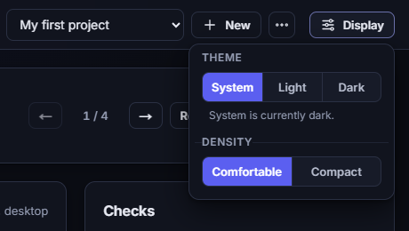

- **Theme:** System, Light or Dark. System follows your operating system.
- **Density:** Comfortable or Compact. Compact fits more rows on screen in the large link, image and comparison tables.

The arrow button at the top of the sidebar collapses it to an icon column to give tables more room. All three choices are remembered in this browser.

| Shortcut | Action |
| --- | --- |
| `Ctrl` + `Enter` | Add the pasted page and open its report |
| `Ctrl` + `Shift` + `Enter` | Add the pasted page and clear the form for the next one |
| `↑` `↓` `←` `→` | Move between report sections (when a section tab has focus) |
| `Home` / `End` | Jump to the first or last report section |
| `Esc` | Close a menu or dialog |

<br clear="right">

## Privacy and storage

- Everything runs locally in your browser. The pasted HTML is parsed with `DOMParser`, so scripts inside it never run, and nothing is uploaded anywhere.
- Projects and pages are saved in this browser's IndexedDB. They survive closing the tab, but clearing site data or browsing history can delete them, so use **Back up project** for anything important.
- If your browser blocks storage for files opened from disk, the sidebar says so and pages last only until you close the tab.
- Image previews load images from the live site. Untick **Show previews** in the Images tab to stay fully offline.

## Project structure

```
index.html         App layout (top bar, sidebar, report navigation, dialogs)
styles.css         Design system: tokens, light and dark themes, density, print layout
fonts/             Inter and JetBrains Mono (variable woff2), bundled so the app works offline
js/parser.js       Extraction engine (DOMParser; scripts in the pasted HTML never run)
js/bulk.js         Cross-page analysis: comparison, duplicates, similarity, link map
js/prompts.js      AI prompt and content brief templates
js/app.js          Interface, projects and storage, report rendering, copy and exports
js/shell.js        App shell: theme and density switches, menus, sidebar collapse
js/sample.js       Fictional sample pages for "Load sample pages"
docs/screenshots/  Images used in this README
tests/             Regression harness (not needed to run the app)
```

To reuse the parser elsewhere (for example in a Next.js dashboard), `js/parser.js` has no dependencies. `Extractor.analyze(html, { pageUrl })` runs in any browser or client component and returns plain JSON.

## Development and testing

The app itself needs no tooling. The `tests/` folder holds an optional regression harness that drives the real app with [Playwright](https://playwright.dev) (`playwright-core`) in Microsoft Edge.

It records a **golden master**: every export, CSV, AI prompt, table content, count and project action for the sample pages. Re-running it after any change shows exactly what differs. This is how interface changes are checked without altering behaviour.

```bash
cd tests
npm install

# Capture the current app and compare it with the recorded baseline
node golden.mjs --root .. --label current
node compare.mjs golden/baseline out/current

# Regenerate the README screenshots (writes to docs/screenshots/)
# The pages it uses are defined in tests/readme-samples.mjs
node readme-shots.mjs
```

The baseline in `tests/golden/baseline` was recorded from the original app (git tag `baseline`), before the interface redesign. `compare.mjs` exits with an error if any output differs.

## Browser support

Built and tested in Chromium-based browsers (Chrome and Edge, current versions). The interface uses modern CSS (`light-dark()`, `:has()`, popovers, `hidden="until-found"`), so a recent browser is required. Firefox and Safari should work for current versions but have not been tested.

## Notes and limitations

- Pixel widths, length ranges and schema "recommended" fields are guidelines. They don't guarantee rankings or rich results.
- Analysis is based on the HTML you paste (a rendered DOM copied from DevTools works best). It does not fetch pages or run JavaScript, so it cannot see content that only exists after a script runs and was not in the copied DOM.
- The bundled fonts, Inter and JetBrains Mono, are licensed under the SIL Open Font License. The license texts are in `fonts/`.
